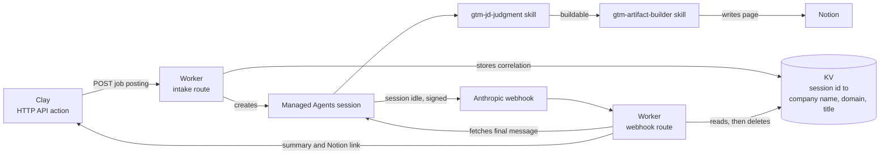

# GTM JD Pipeline

An unattended agent that reads a GTM-engineer job posting and decides, on its own, whether to build a
free proof-of-work sample for that company. When it decides yes, it builds the sample, writes it to
Notion, and hands a summary and a link back to the sales pipeline. No human in the loop between the job
posting arriving and the sample existing.

**Stack:** Clay · Cloudflare Workers · Claude Managed Agents · Notion · GitHub

---

## The problem

Cold outreach that says "we can help with X" is easy to ignore. Outreach that says "here's X, already
built for you" is not. Manually building a real sample for every lead doesn't scale, so this pipeline
automates the judgment call and the build itself.

The job postings arriving here have already cleared one filter: Clay's own Find Jobs source only admits
postings that match a GTM-engineer title taxonomy, so every posting this pipeline sees is already a
real, qualified lead. The question this pipeline answers isn't "is this company worth it", that's
already settled. It's narrower and harder to get right: **what, if anything, is small enough and close
enough to GTMA's actual capabilities to build as a sample in minutes, not days**, and "nothing" is a
completely valid, expected answer for a real fraction of postings, not a failure.

## Where this fits

This repository is one stage in a larger Clay-run pipeline, not the whole system. Upstream, Clay sources
real GTM-engineer job postings from LinkedIn and enriches each one (company domain, LinkedIn URLs) before
calling this pipeline per posting. Downstream, once this pipeline's result lands back in the row, Clay
finds the hiring decision-maker at that company, enriches their contact details, and pushes the finished
lead into its outbound sequencer, now carrying a real sample instead of a cold introduction. Both of
those stages run in Clay itself and live outside this codebase.

## Scope

**In scope**
- Judging one job description against GTMA's actual, current build capabilities
- Picking the single cheapest, fastest buildable thing in the posting, not the most prominent one
- Building that one thing in whatever tool it actually lives in
- Writing the finished artifact to Notion and relaying a summary and link back to Clay
- Treating "nothing buildable" as a valid outcome, with a reasoned explanation, not a dead end

**Out of scope**
- Creating or editing Clay workflows and tables. Clay's own public API has no creation endpoints of any
  kind for either, confirmed against its OpenAPI spec, so this is UI and browser-OAuth only, regardless
  of which API key the agent holds
- Deciding whether the company itself is worth pursuing, that's already decided upstream by Clay's title
  filter before a posting ever reaches this pipeline
- Finding or verifying the hiring manager's contact details, that happens later in the Clay pipeline
- Sending the actual outreach, that's Clay's Sequencer, not this system

## Architecture



A single Cloudflare Worker owns both ends: it starts the session when Clay sends a posting, and it
relays the result back when Anthropic reports the session is done. Nothing about this loop is
synchronous end to end. The intake call returns immediately with a session id; the real result arrives
minutes later through the webhook, correlated back to that session via the KV entry.

## The build, stage by stage

| # | Stage | Where | What happens |
|---|---|---|---|
| 1 | Intake | Worker, intake route | The `x-intake-secret` header is checked first; then `company_name` and `job_description` must be present. Either check failing returns an error before any session is created |
| 2 | Session creation | Worker → Anthropic | Starts a Managed Agents session: the repo is mounted as a resource (skills + `capabilities.md`), the credential vault is attached, and the job posting is sent as the opening message |
| 3 | Correlation stored | Worker → KV | The new session id is mapped to `company_name`, `company_domain`, `job_title`, so the webhook can reattach them later. The webhook event itself only ever carries the session id |
| 4 | Judgment | Agent: `gtm-jd-judgment` | Reads `capabilities.md` at run time, pulls every distinct ask out of the posting, and picks the single cheapest and fastest one that's genuinely buildable, or returns `buildable: false` with its reasoning |
| 5 | Build | Agent: `gtm-artifact-builder` | Builds the chosen target in whatever tool it actually lives in, then writes the full artifact to a Notion page via a direct REST call |
| 6 | Completion | Anthropic → Worker | A signed webhook fires once the session goes idle; the Worker verifies the signature before trusting anything in it |
| 7 | Result extraction | Worker | Fetches the session's own event history, checks the stop reason before trusting the last message, then parses the agent's final JSON out of it |
| 8 | Relay | Worker → Clay | Merges the stored correlation with the extracted result and posts the combined payload to Clay's webhook |

## The two-skill contract

`gtm-jd-judgment` runs first and returns:

```json
{
  "buildable": true,
  "build_type": "workflow",
  "build_target": "a short, concrete spec of exactly what to build",
  "source_jd_excerpt": "the exact line(s) from the posting that justified this pick",
  "reasoning": "why this was the easiest match among everything the posting asked for"
}
```

or, when nothing clears the bar, `buildable: false` with `build_type`, `build_target`, and
`source_jd_excerpt` all `null`, plus a `reasoning` string naming what was considered and why none of it
held up. A posting with no buildable ask still exists in the pipeline; it just skips the artifact step
entirely.

`gtm-artifact-builder` only ever runs on a `buildable: true` result, and trusts that decision completely,
it never re-evaluates fit, only execution. It returns:

```json
{
  "build_status": "built",
  "artifact_doc_url": "https://www.notion.so/...",
  "summary": "one or two sentences, written the way it would read in a cold email",
  "build_type": "workflow"
}
```

`build_status` is `"built"` for a real working artifact, `"spec_only_needs_manual_step"` when the target
is table-shaped and needs a few minutes of manual UI work Clay's API can't do, or `"blocked"` when
something the build genuinely needs isn't available, named directly instead of faked.

The Worker merges this with the stored correlation fields before it reaches Clay. See
[`docs/sample-intake.json`](docs/sample-intake.json) for what Clay sends in, and
[`docs/sample-result.json`](docs/sample-result.json) for the final shape Clay receives back (both
fictional).

## Failure handling

| Risk | How it's handled |
|---|---|
| Unauthenticated intake calls | `x-intake-secret` header checked against a Worker secret; missing or wrong returns 401 before the body is even parsed |
| Missing required fields | 400 returned before any session is created |
| Forged webhook calls | HMAC-SHA256 signature verification, the same Standard Webhooks scheme Stripe and Svix use |
| Replayed webhook deliveries | Deliveries older than 5 minutes are rejected |
| Duplicate completion events | Both `idle` and `terminated` can fire for one session; the KV entry is claimed and deleted by whichever arrives first, so Clay never gets the result twice |
| Session finishes badly (retries exhausted, an error) | The stop reason is checked before trusting the last message; a clean error goes to Clay instead of a half-finished fragment that looks like a real answer |
| Agent's final message isn't valid JSON | Caught; the raw text is returned with `parse_error: true` instead of crashing the relay |
| Stale sessions | KV correlation entries expire automatically after 7 days |

## Design decision: why Notion, not Google Drive

The artifact used to get written to a Google Doc via a Google Drive MCP server and an OAuth vault
credential. Dropped entirely after it ate multiple full debugging days across several real problems, in
the order they were hit:

1. **Three separate Google Cloud APIs had to be enabled one at a time**, Drive API, then (discovered
   only after a failure) Docs API, then (checked separately) a distinct Drive MCP API, each one a silent
   prerequisite with no single error pointing at what was actually missing.
2. **The OAuth consent screen defaulted to "Internal" user type**, meaning only accounts inside the
   Google Workspace domain it was created under could ever authenticate, not a scope or test-user issue,
   a hard platform restriction with no bypass. Had to be explicitly flipped to "External" plus "Testing."
3. **Testing-mode refresh tokens expire after exactly 7 days**, confirmed directly in the OAuth token
   response, regardless of use. That meant the credential needed manual re-authorization through
   Google's OAuth Playground roughly every week, indefinitely, for as long as the integration existed.
4. **Even with a technically valid token and correct scope**, the Drive MCP server returned a bare
   "the caller does not have permission" with zero further detail, no error code, no reason, on every
   call, create, list, search alike, which took a full day to even localize to the right layer.
5. **Google Workspace's domain-level app access control** can independently block an otherwise
   correctly-consented OAuth app, a restriction invisible from inside the OAuth flow itself and fixable
   only by a Workspace admin. This is what the permission errors ultimately traced back to, confirmed by
   switching the authorizing account to a personal Gmail account and having it work immediately with
   identical scopes.

Replacement: a plain Notion internal integration token, not OAuth, no consent screen, no expiry, created
once in Notion's own integrations settings. Stored as a vault credential scoped to Notion's API domain
only. No MCP server at all, the agent calls Notion's REST API directly via `curl` in bash, per the
instructions in `gtm-artifact-builder/SKILL.md`.

## Known limitations

- **One live run on the Notion integration hit an unexplained mid-task retry exhaustion**, right after a
  local file write and shortly before the actual Notion API call, but the session still recovered and
  completed the build successfully. Root cause unconfirmed, possibly a transient provider-side rate
  limit unrelated to Notion specifically. One occurrence isn't enough to call it a pattern.
- **Clay workflow and table creation is unreachable by the hosted agent**, by design, not by gap. See
  Scope above and `capabilities.md`.
- A handful of GTMA's real capabilities (RevOps process work, CRM data cleaning, revenue-system
  architecture, agent building) are named in `capabilities.md` but not yet demonstrated in an actual
  build through this pipeline.

## Setup

### Cloudflare Worker secrets

```bash
npx wrangler secret put ANTHROPIC_API_KEY
npx wrangler secret put ANTHROPIC_WEBHOOK_SIGNING_KEY
npx wrangler secret put CLAY_WEBHOOK_URL
npx wrangler secret put GITHUB_TOKEN
npx wrangler secret put INTAKE_SECRET
```

`INTAKE_SECRET` is the shared value Clay's HTTP API action must send back as the `x-intake-secret`
header on every call. Pick any strong random string.

### Vault credentials

A vault holds the credentials the hosted agent can use mid-session. Create one in the Anthropic Console,
put its id in `wrangler.toml` as `VAULT_ID`, then add:

| Credential | Type | Scoped to |
|---|---|---|
| Clay API key | API key | Clay's public API domain |
| FullEnrich API key | API key | `app.fullenrich.com` |
| Notion integration token | API key | `api.notion.com` |

Each one is a plain, non-expiring API key stored as an `environment_variable`-type vault credential,
injected only when a request goes to its allowed host, never exposed to the agent directly.

Create a Notion page to hold every artifact this pipeline writes, share it with your Notion
integration, then replace `<YOUR_NOTION_PARENT_PAGE_ID>` in `gtm-artifact-builder/SKILL.md` with that
page's id.

### Deploy

```bash
npx wrangler deploy
```

`git push` alone does not deploy the Worker, it only updates what the Managed Agent reads from the
mounted repo (skills, `agent.yaml`, `capabilities.md`). The Worker itself only goes live on
`wrangler deploy`, or incidentally via `wrangler secret put`, which bundles whatever code is on disk at
that moment along with the secret change.

### Test

```bash
curl -X POST https://<your-worker>.workers.dev/ \
  -H "Content-Type: application/json" \
  -H "x-intake-secret: <your INTAKE_SECRET>" \
  --data @docs/sample-intake.json
```

Returns immediately with `{"status":"processing","session_id":"..."}`. The real result arrives later via
the webhook, not in this response.

## Debugging

```bash
npx wrangler tail
```

shows a log line the instant the Worker handles any request. It's purely passive and has no memory of
anything before it connects, so start it before triggering a test call, not after.

To check a specific session's outcome directly, independent of tail's timing:

```bash
ant beta:sessions retrieve --session-id sesn_...
```

`status: idle` means it finished. To see exactly what it did step by step:

```bash
ant beta:sessions:events list --session-id sesn_... --max-items -1 > /tmp/events.json
```

---

Built by Chris Mbanta · GTM Engineer
